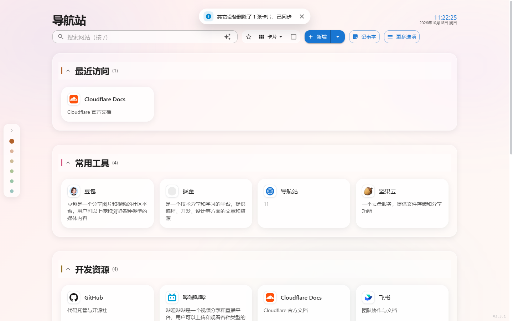
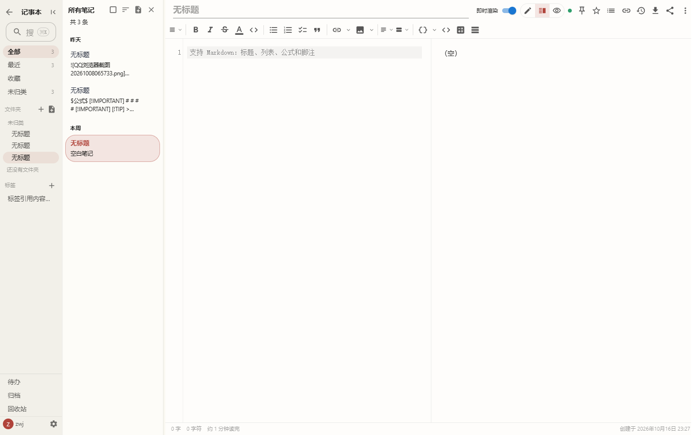
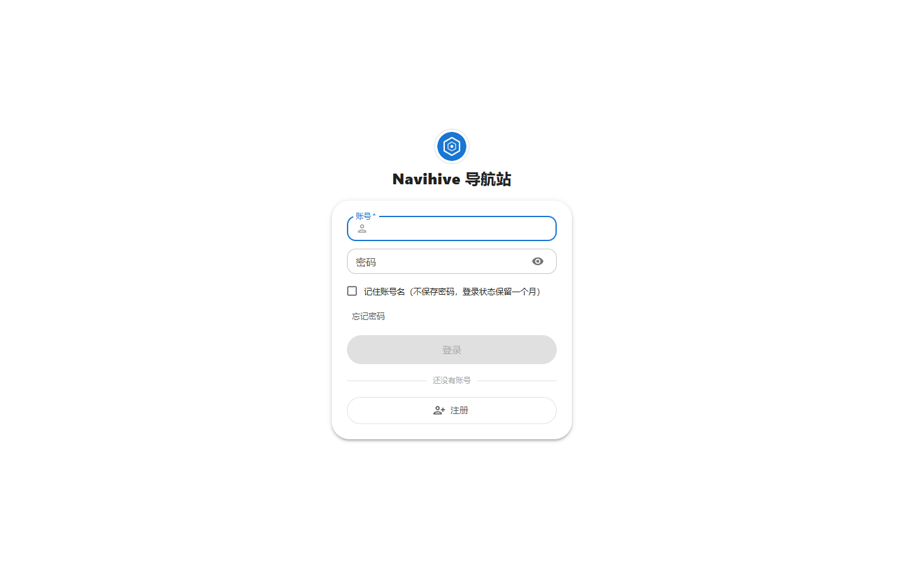
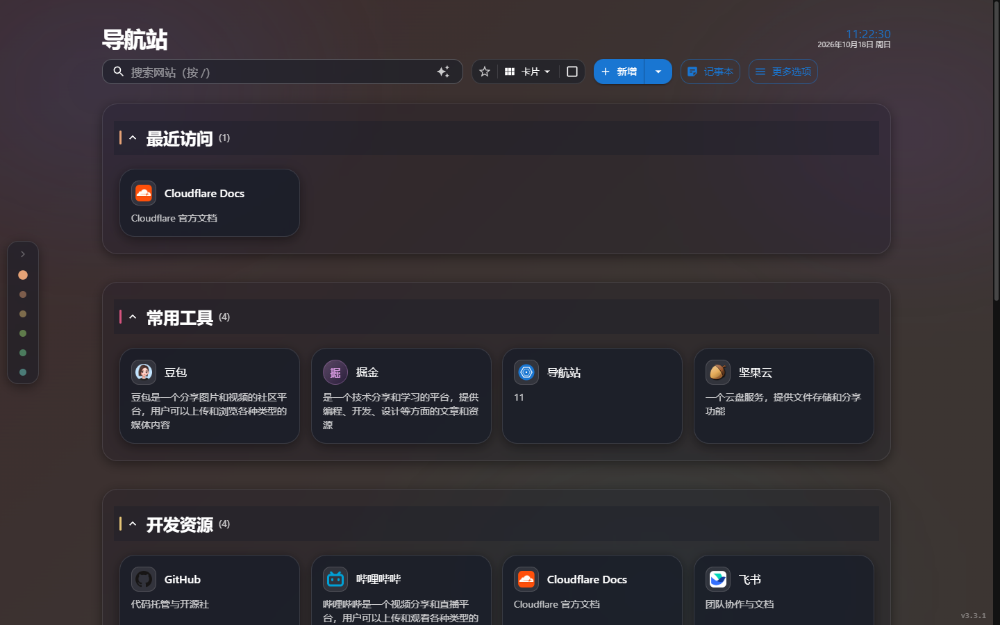
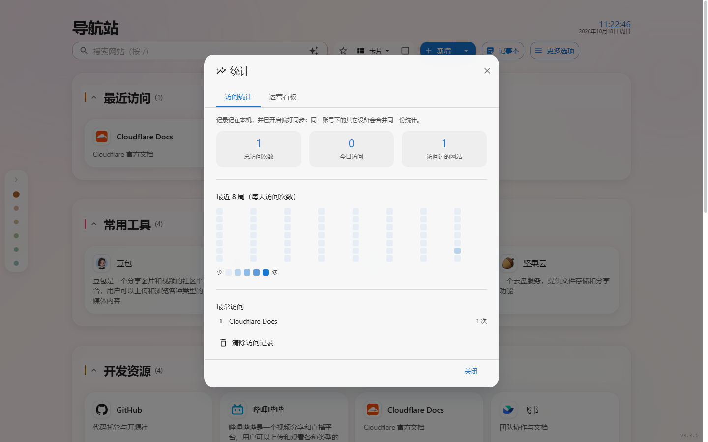

<div align="center">

# NaviHive · 个人导航站 + 记事本


**一套代码，两种形态**：部署到 Cloudflare 全球边缘网络（Workers + D1），或用 Docker 自托管（Node + SQLite），功能完全一致。



</div>

## ✨ 功能总览

### 🔖 导航站

- **分组管理** — 分组收起/展开、强调色条、卡片计数；删除进回收站，可还原/彻底删除
- **拖拽排序** — 网站卡片跨分组拖拽，顺序与跨组移动一次请求保存；分组也可拖
- **搜索** — `/` 全局唤起：拼音检索、高级语法（`tag:` `group:` `url:` `is:starred` `is:dead`、`-排除词`）、可选 AI 语义排序
- **筛选** — 只看星标 / 只看失效（链接健康探测：连续两次失败才标记，可重新检测/标记可访问）
- **卡片信息** — 站点账号密码（加密落库、一键复制）、描述、自动获取图标（图标 API 模板，`{domain}` 占位符）
- **外观** — 亮/暗/跟随系统、主题色、玻璃效果、清爽模式、背景图 + 蒙版透明度、自定义 CSS、按账号保存
- **命令面板 / 统计看板** — 访问统计热力图、运营看板（站点所有者）
- **更多选项** — 顶栏「更多选项」（窄屏在底部导航栏「更多」）打开一个统一中心：左栏分组，右侧换面板。更多选项 → 统计 即访问热力图与运营看板；备份与恢复、回收站、审计日志、全站设置、AI 设置、密码保险库、账号与安全、快捷键与操作帮助等入口都收在这里

### 📓 记事本

- **编辑器** — CodeMirror 分屏实时预览、行内渲染、打字机模式、查找替换、命令面板、大纲面板、分屏双编辑
- **语法** — Markdown + 表格 + KaTeX 公式 + Mermaid/图表 +脚注 + Wiki 链接（`[[目标|别名]]`）+ 块引用 `#标题` 锚点 + front-matter
- **组织** — 多级文件夹（图标/颜色）、标签（重命名/合并）、置顶/收藏、待办聚合视图
- **双链** — `[[双链]]` + 反向链接面板 + 笔记图谱（深度/范围可调、分组着色）
- **数据** — 全文检索（D1 FTS5 / SQLite FTS5，支持手动重建）、版本历史（行级 diff）、回收站
- **附件** — 图片上传（粘贴/拖拽进正文，存 KV）、附件管理器、服务端读图尺寸
- **备份与同步** — WebDAV 自动备份（ZIP + manifest，按账号隔离）、跨设备轮询增量同步（Cursor 增量）、多标签页 BroadcastChannel 同步
- **分享** — 单篇笔记 / 整个分组生成公开链接（`/s/<token>`、`/sg/<token>`），可设访问口令、浏览次数防刷、随时撤销



### 👥 账号与安全

- **多账号** — 邀请码注册（30 分钟有效、一次性），账号间数据完全隔离；各账号独立的外观 / WebDAV 配置 / 备份
- **恢复密钥** — 浏览器内生成 Ed25519/ECDSA 密钥对，公钥存库、私钥离线保管；登录页上传私钥即可自助重置密码（无需命令行）
- **登录设备管理** — 设备列表、一键下线其它设备（同设备指纹自动判重折叠）
- **沉睡治理** — 长期未登录的普通账号自动停用（数据保留）→ 宽限期后清除；站点所有者（owner）不受治理、不可注销
- **审计日志** — 登录、改密、删除、备份配置变更等关键操作的时间 / 操作者 / 来源 IP
- **限速与防爆破** — 登录 / 改密 / 恢复接口按来源 IP 限速；维护模式一键只读

## 📸 页面截图

| | |
| --- | --- |
|  |  |
| _登录页（邀请码注册入口）_ | _暗色模式_ |
|  |  |
| _访问统计（本地记录 + 跨设备合并）_ | _记事本工作区（列表 / 编辑 / 实时预览）_ |

## 🚀 部署

### 方式一：Cloudflare Workers（免费、全球边缘）

1. 点击 **Deploy to Cloudflare Workers** 按钮（或 `https://deploy.workers.cloudflare.com/?url=https://github.com/zwjttztt/Cloudflare-Navihive1`），登录 Cloudflare 账号后点 **Deploy**。
2. 配置凭据 secret（**不要**写进 `wrangler.jsonc`，会明文进 Git）：

   ```bash
   wrangler secret put AUTH_USERNAME
   wrangler secret put AUTH_PASSWORD
   wrangler secret put AUTH_SECRET      # 令牌签名 + 数据落库加密（可拆成 JWT_SECRET / DATA_ENCRYPTION_KEY，见下）
   ```

3. **改绑定（手动部署必做）**：`wrangler.jsonc` 里的 `d1_databases[0].database_id` 与
   `kv_namespaces[0].id` 目前填的是**作者本人的实例**。不换的话，要么部署失败，要么把自己的数据写进别人的库
   （表现为 500 或一直空数据）。自己建一份再把 ID 填回去：

   ```bash
   wrangler d1 create navigation-db        # 输出里的 database_id → d1_databases[0].database_id
   wrangler kv namespace create FILES_KV   # 输出里的 id → kv_namespaces[0].id
   ```

   用第 1 步的一键部署按钮可以**跳过本步** —— 按钮会自动创建 D1 / KV 并把 ID 写进配置。
   （D1 的 ID 是公开标识符、不是密钥，写进 Git 不泄露数据，见 `wrangler.jsonc:39-42` 的注释。）

4. 初始化数据库：Cloudflare 控制台 → D1 → `navigation-db` → SQL 控制台，粘贴运行根目录的 `init_table.sql`（可删掉示例数据段再跑）。
5. 部署完成得到 `https://<worker名>.<你的子域>.workers.dev`，首次登录后**立即改密码**，并给备份设独立口令。

> ⚠️ **用 Workers Builds（连接 GitHub 自动部署）时，`wrangler.jsonc` 的 `name` 必须与 Cloudflare dashboard 上的 Worker 名完全一致**，否则部署失败（`validate that the Worker name matches...`，code 10013）。secret 是按 Worker 存的，换名要重配。
>
> 自定义域名：控制台 → 触发器 → 自定义域，按提示配 DNS 即可。

### 方式二：Docker 自托管（单容器 + 宿主机反代）

```bash
git clone https://github.com/zwjttztt/Cloudflare-Navihive1.git
cd Cloudflare-Navihive1
cp .env.example .env        # 必须设置 AUTH_SECRET（openssl rand -base64 32）
docker compose up -d --build
```

- 容器只监听 `127.0.0.1:8787`，TLS 由宿主机 Nginx/Caddy 终止（配置见 `deploy/nginx/`，完整手册见 [`deploy/selfhost.md`](deploy/selfhost.md)）；
- SQLite 库与附件落在命名卷，容器重建不丢数据；
- 也可以直接用预构建镜像（GitHub Actions 自动 multi-arch 构建，amd64 + arm64）：

  ```bash
  docker pull ghcr.io/zwjttztt/navihive:latest
  ```

- 定时任务（每周导航备份、笔记自动备份、死链巡检、沉睡治理扫描）由容器内置调度执行，无需外部 cron。

### 忘记密码？

1. **上传恢复私钥重置（推荐，两种形态都能用）**：登录页 →「忘记密码」→ 上传此前在「账号与安全 → 恢复密钥」生成的私钥文件。账号名可留空（服务端拿公钥逐个验签）。私钥只在本机签名、从不上传。
2. **命令行签重置令牌（两种形态都能用）**：`node scripts/recovery-token.mjs sign --username admin --password '新密码'`，把打印出的令牌粘进登录页。前提是服务端配了 `AUTH_RECOVERY_PUBLIC_KEY`，或者在「账号与安全」里生成过恢复密钥（公钥已入库）。
3. **直接改库（只适用于 Cloudflare 部署）**：`node scripts/reset-admin-password.mjs --password '新密码'`。它执行的是 `wrangler d1 execute <库名>`，改的是**云端 D1** 里 `configs` 表的 `auth.password` / `auth.username`，需要本机有 wrangler 登录态。

> ⚠️ **自托管（Docker / systemd）下第 3 条完全无效，而且它会骗你说成功了。**
> 自托管的库是容器卷里的 SQLite 文件（`/app/data/navihive.db`），`wrangler d1 execute` 连不到它。
> 但只要本机 wrangler 还登着 Cloudflare 账号，脚本就会照常打印「✅ 管理员密码已重置」——
> 你机器上的库一个字节都没变（更糟的情形：它真去改了云端那份早就没人用的旧 D1）。
> 于是你拿新密码登不进去，还会去怀疑别的地方。
>
> 自托管的正确顺序：
> ① 还登得进去 → 直接在站内「账号与安全」里改密码；
> ② 登不进去、手上有恢复私钥 → 走上面第 1 或第 2 条（恢复令牌这条路自托管同样有效）；
> ③ 两条都不成立 → 只能手工改库，**目前没有官方脚本做这件事**。值必须是
> `pbkdf2$<迭代次数>$<salt>$<hash>`（PBKDF2-SHA256、16 字节盐、32 字节输出、base64url 无填充，
> 见 `src/API/crypto.ts:228-249`），写错的表现是「密码明明对，就是登不进」。改之前先停服、先备份库文件。
> 细节见 [`deploy/selfhost.md`](deploy/selfhost.md) 第九节。

> ⚠️ 用 `reset-admin-password.mjs` 会把 `auth.tokenVersion` +1：**所有已签发的登录会话立即全部失效**，
> 每台设备都得重新登录，旧密码也同时作废。这是有意的设计（改密 = 吊销旧令牌），
> 但如果你的脚本里还留着别的设备的自动化流程，它们会在这一秒一起掉线。

> 设计取舍：不提供任何「共享重置码」这类可被暴力猜解的公开入口。

## 🔐 密钥说明

| 环境变量 | 作用 | 缺失时 |
| --- | --- | --- |
| `AUTH_SECRET` | 兜底：令牌签名 + 数据加密 | 必填 |
| `JWT_SECRET` | 仅登录令牌签名（可与 AUTH_SECRET 拆分） | 回退 `AUTH_SECRET` |
| `DATA_ENCRYPTION_KEY` | 仅站点密码 / WebDAV 凭据落库加密 | 回退 `AUTH_SECRET` |
| `JWT_SECRET_OLD` | 轮换 `JWT_SECRET` 期间的旧值（只验签，过渡后删除） | 不启用 |

- 密文自带 keyId（`enc$1$...` = 新钥，`enc$...` = 旧钥），新旧同时可读，换钥无需停机迁移；
- ⚠️ **备份默认不加密**：不设「备份密码」时，服务端把**原始 zip 直接上传到你的网盘**
  （`worker/notesBackup.ts:393` 是 `password ? await encryptBackup(zip, password) : zip`），
  里面含全部笔记、附件，以及站点账号密码。只有设了备份密码才会先加密再上传，
  且它与 `AUTH_SECRET` 解耦 —— 轮换服务端密钥不影响已有备份。**建议务必设置备份密码。**
- `NAVIHIVE_TRUST_XFF`：本地 `wrangler dev` 时默认不信任 X-Forwarded-For（防伪造绕过限速），仅当确认反代会覆盖 XFF 时设 `1`。

### 自托管（Docker / Node）专用变量

这几个不写进 `wrangler.jsonc`，只在自托管形态生效；默认值都是从代码里读出来的（不是猜的）。

| 变量 | 默认值 | 作用 | 什么时候该改 |
| --- | --- | --- | --- |
| `NAVIHIVE_IMAGE` | `ghcr.io/zwjttztt/navihive:latest` | 网页一键升级时拉取的目标镜像（应用容器与 upgrader 各读一次，两边必须一致） | ⚠️ **这是回滚到旧版本的唯一旋钮**：把它指到 GHCR 上的 `<sha>` tag（如 `ghcr.io/zwjttztt/navihive:<commit-sha>`）再点升级，就退回那一版；平时不用动 |
| `NAVIHIVE_UPGRADE_SPOOL` | 空（不启用） | 升级请求目录。设了就进入 spool 模式：应用容器只往这个共享卷写请求文件，由独立的 upgrader 容器执行 `docker compose up`，**应用容器零 Docker daemon 权限** | `docker-compose.yml` 已固定设成 `/spool`；只有自己另写 compose（或纯 `docker run`）时才需要手填，不填则网页升级不可用 |
| `NAVIHIVE_SLOW_QUERY_MS` | `50` | 慢查询阈值（毫秒），≥ 阈值的 SQL 打一条摘要日志（字面量已脱敏、不记绑定值） | 排障时临时调低看更多；嫌日志吵就调高；**设 0 或负数 = 关闭打点**（不是「全记」） |
| `NAVIHIVE_COMPOSE_DIR` | 空（读容器标签 `com.docker.compose.project.working_dir`） | upgrader 要 bind 的 compose 目录绝对路径 | 只在容器标签被写歪（见到 `/compose`）或纯 `docker run` 启动时兜底用；正常 compose 部署别设 |
| `NAVIHIVE_DOCKER_SOCK` | `/var/run/docker.sock` | Docker socket 路径（仅应用容器走 unix socket 时需要） | 宿主 sock 不在默认位置（如 rootless docker）时才改 |
| `NAVIHIVE_UPGRADE_DIR` | — | **已废弃，代码不再读取**。它要求用户手填 compose 目录，是早期网页升级一律 501 的根因，现由容器标签 + `NAVIHIVE_COMPOSE_DIR` 取代 | 不用设；看到旧文档让你设它，说明那份文档过期了 |

完整清单（端口 / 路径 / 定时任务 / 限速 / 会话等全部 `NAVIHIVE_*`）见 [`deploy/selfhost.md`](deploy/selfhost.md) 第三节。

## 🛠️ 技术栈

- **前端**：React 19 · TypeScript · Material UI 9 · DND Kit · CodeMirror 6 · Vite（rolldown）
- **后端**：Cloudflare Workers + D1 + KV（云形态）/ Node + SQLite + 文件 KV（自托管形态，`server/` 同一份路由代码）
- **测试**：node:test + esbuild 单测 / DOM 测试（jsdom）· CDP 真机探针 · a11y / 对比度双审计 · 冒烟
- **浏览器基线**：chrome >= 111 · edge >= 111 · firefox >= 111 · safari >= 16.4（与 `browserslist` 一致；
  CI 只有 Chromium，WebKit 差异靠 `tests/safariApiGuard.test.ts` 的静态守卫兜底，详见
  [`docs/architecture.md` §5.1](docs/architecture.md)）

## 🧪 本地开发

### 第 0 步：先建 `.dev.vars`（不建就打开页面 503）

`wrangler.jsonc` 里 `AUTH_ENABLED` 是 `"true"`，`worker/index.ts` 又在 `fetch` 最前面检查
`AUTH_SECRET`：缺了它一律 503，**连静态资源都进不去**（`assets.run_worker_first: true`，
请求根本到不了前端，所以看到的是白屏而不是登录页）。一条命令生成（Git Bash / macOS / Linux 通用）：

```bash
printf 'AUTH_SECRET=%s\nAUTH_USERNAME=root\nAUTH_PASSWORD=dev-only-change-me\n' "$(openssl rand -hex 32)" > .dev.vars
```

`AUTH_USERNAME` / `AUTH_PASSWORD` 是**空库时唯一能登进去的账号**（不写这两行，本地库就是一座空城，登录页没有可用凭据）；
写进去之后首次登录会被强制改密，改完以库里为准，之后再改 `.dev.vars` 里的密码不会影响已生效的账号 —— 想重来就删 `.wrangler/state`。
没有 `openssl`（少见）时用 `node -e "console.log(require('crypto').randomBytes(32).toString('hex'))"` 生成那串值。

> ⚠️ **不建 `.dev.vars` 时 `npm run dev` 会全站 503，这是有意的，不是 bug。**
> 缺密钥时「凭据加密」等价于明文（站点密码、WebDAV 口令都能被反推），所以宁可拒绝启动也不降级。
> 503 文案写的「请在部署环境里设置 AUTH_SECRET 后重新部署」在本地指的就是这个 `.dev.vars` —— 别去 Cloudflare 后台找。
>
> `.dev.vars` 已被 `.gitignore` 的 `.dev.vars*` 覆盖，不会误提交；要加更多本地变量直接往里追加。

### 然后再跑命令

```bash
npm ci            # 安装依赖（Node 22+）。本项目只用 npm，不要用 pnpm / yarn
npm run dev       # 本地开发（Vite + workerd，自动读上面的 .dev.vars）
npm test          # 全量单测 / DOM 测试
npm run build     # 构建（tsc -b + vite build）
npm run smoke     # 真实浏览器冒烟（CDP）
npm run e2e       # API 端到端
npm run audit:a11y && npm run audit:contrast   # 可访问性 / 对比度审计
```

> 本地 D1 是空库也没关系：每个请求进来都会先跑一次 `api.migrate()` 补齐表结构（同一 isolate 内只跑一次），
> 不需要手动执行 `init_table.sql` —— 那个脚本只给线上 D1 用。数据落在 `.wrangler/state/`，想清空就删这个目录。
>
> ⚠️ 为什么强调**只用 npm**：仓库提交的锁文件是 `package-lock.json`，`pnpm-lock.yaml` 从来没有进过版本库。
> 用 pnpm / yarn 装出来的依赖树没有任何锁文件约束（`^` 范围当天全取最新），而 `node_modules` 不会出现在 diff 里，
> 这种偏差事后完全查不出来 —— 出问题的人复现不了 CI 的环境。锁文件因此**故意不被 gitignore**：
> 真有人用 pnpm，多出来的 `pnpm-lock.yaml` 会立刻在 `git status` 里露出来。

> 仓库的合入门禁：`tsc -b --force` + ESLint + 全量测试 + build + smoke + e2e + 双审计全绿才允许推送；CHANGELOG 随版本更新（`script/bump-version.mjs` 按变更规模自动跳 patch/minor/major）。

## 🗂️ 项目结构

```
├── worker/                 # 后端路由与领域逻辑（两形态共用：routes/ + lib/ + cron）
│   ├── index.ts            # 唯一入口：按 env.ASSETS 区分 Cloudflare / 自托管
│   └── routes/             # API 路由（分组/站点/笔记/账号/备份/运维）
├── server/                 # 自托管宿主（node:sqlite D1 适配器、文件 KV、静态服务）
├── src/                    # 前端（React）
│   ├── App.tsx             # 主应用（导航站）
│   ├── components/         # 组件（卡片 / 弹窗 / notes/ 记事本工作区）
│   ├── hooks/              # 搜索、多选、账号会话等编排层
│   ├── context/            # UI 偏好（星标/标签/失效记录/主题，按账号分桶）
│   └── API/                # API 客户端与类型
├── shared/                 # 前后端共享类型与常量
├── tests/                  # 单测 / DOM 测试 / 静态守卫
├── script/ scripts/        # 构建、测试、运维脚本（单测 runner、恢复令牌、改密）
├── deploy/                 # 自托管手册、nginx 配置、compose 模板
├── docs/                   # 设计文档与历史排查报告
├── init_table.sql          # Cloudflare D1 初始化脚本
├── Dockerfile / docker-compose.yml
└── wrangler.jsonc          # Cloudflare 配置（D1 / KV / assets / cron）
```

## 📄 许可证与致谢

基于 [MIT](LICENSE) 许可证发布。核心代码来自 [NaviHive](https://github.com/jiangxiaobaicool/Cloudflare-Navihive1)，感谢原作者。技术栈致谢：React · Material UI · CodeMirror · DND Kit · Cloudflare Workers · Vite。
