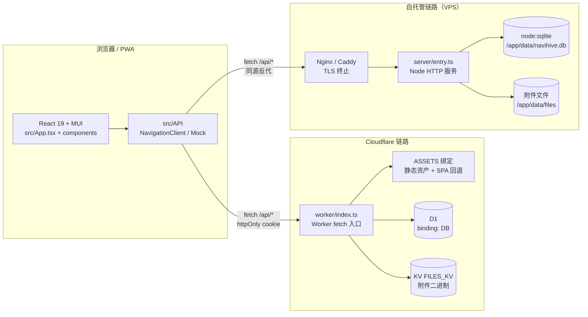
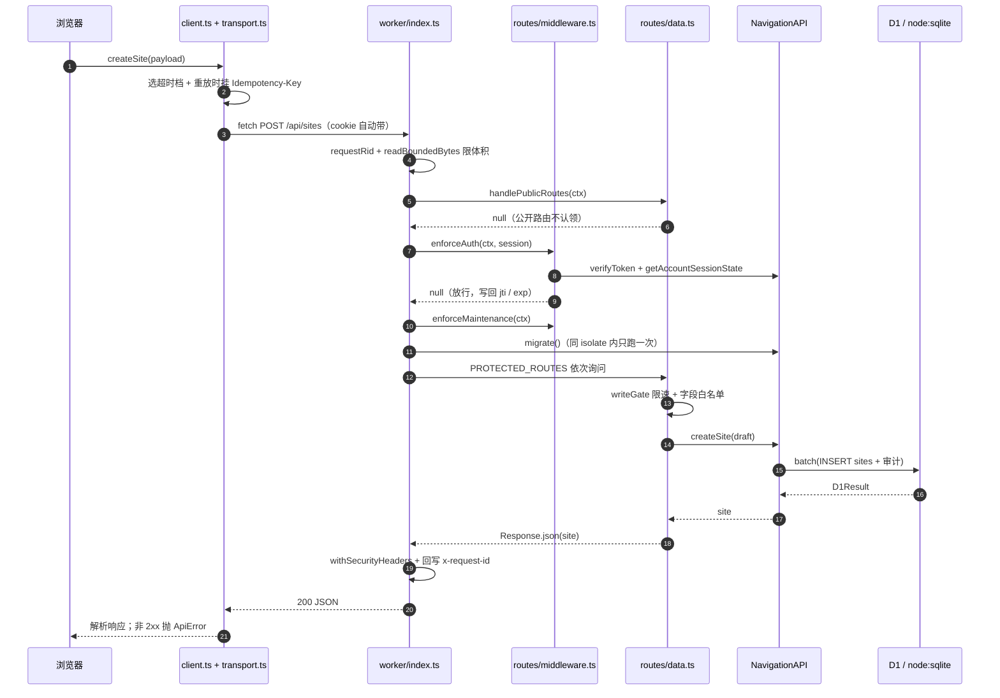
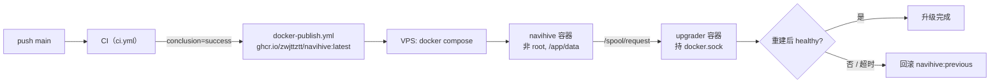

# NaviHive 架构说明

这份文档回答三件事：**同一份代码怎么同时跑在 Cloudflare 与自托管两条链路上**、**一次请求从浏览器到数据库经过哪些层**、**构建产物为什么这样分包**。
代码改动后需要同步更新的章节：改路由分发 → §3；改表或迁移步骤 → §4；改 `vite.config.ts` 的分包规则 → §6；改 CI / compose → §7。
端点清单不在这里，见 [`api.md`](./api.md)。

---

## 1. 部署拓扑

同一个仓库、同一份 `worker/` 与 `src/API/`，靠 **`env.ASSETS` 绑定是否存在**区分两条部署链路（`worker/index.ts:146-171` 的注释写明这条约定）。



两条链路的分工差异（都来自源码，不是推测）：

| 维度 | Cloudflare | 自托管 |
| --- | --- | --- |
| 入口 | `worker/index.ts` 的 `default.fetch` | `server/entry.ts` 的 `createServer` 回调，内部仍调 `handler.fetch` |
| 数据库 | D1（`wrangler.jsonc` 的 `d1_databases`，binding `DB`） | `server/sqlite-d1.ts` 把 `node:sqlite` 包成 D1 形状 |
| 附件 | R2（未开通）→ KV `FILES_KV` 双通道，见 `worker/attachments.ts` | `server/file-kv.ts` + `NAVIHIVE_FILES` 目录 |
| 静态资源 | `assets.run_worker_first: true`，Worker 转发 `env.ASSETS.fetch()` | `server/static.ts` 直接服务 `dist/client`，含 SPA 回退 |
| 定时任务 | `triggers.crons`（仅一条 `0 * * * *`）→ `scheduled()` → `worker/cron.ts` | 进程内定时器，或外部打 `POST /__cron`（`NAVIHIVE_CRON_TOKEN` 校验） |
| 独有端点 | 无 | `POST/GET /api/system/upgrade`、`GET /api/system/slow-queries` |

`server/entry.ts` 里还有一段**进程内自调用**：升级端点先 `handler.fetch(new Request("http://internal/api/auth/me"))` 复用 Worker 的鉴权，确认调用者是 owner 后才动手（`server/entry.ts:999` 起为 POST 升级，`:1141` 起为 GET 升级进度，`:1188` 起为慢查询）。

---

## 2. 目录职责

| 路径 | 职责 | 说明 |
| --- | --- | --- |
| `worker/` | Cloudflare 侧全部服务端代码 | 入口 `index.ts` + `routes/` 分发 + 各领域模块（`ai.ts`、`attachments.ts`、`icon.ts`、`cron.ts`、`webdav/`…） |
| `worker/routes/` | 路径分发与请求体校验 | 只做「认领路径 + 校验形状 + 调 `api.*`」，业务逻辑不在这里 |
| `server/` | 自托管 Node 服务 | `entry.ts` 组装 HTTP 服务；`sqlite-d1.ts` 是 D1 适配器；`static.ts` 静态资源；`upgradeHealth.ts` / `upgradeAudit.ts` 支撑网页端升级 |
| `shared/` | 两端共用的小模块 | `apiErrorCodes.ts`、`requestId.ts`、`sessionCookie.ts`、`spaRoutes.ts`、`logger.ts`、`maintenance.ts`。**零依赖**，会被打进 worker 与首屏两条产物链 |
| `src/API/` | 前后端共用的业务层 | `navigationApi.ts` 是 `NavigationAPI` 类（两端共用）；其余为浏览器客户端与类型 |
| `src/API/methods/` | `NavigationAPI` 的域方法体 | 建表 SQL、迁移步骤、SQL 都在这里 |
| `src/API/clientMethods/` | `NavigationClient` 的域方法体 | `auth` / `notes` / `sites` / `system` / `vault` |
| `src/components/` | 101 个组件 | 弹窗类走 `lazy()`，首屏只有导航骨架 |
| `src/hooks/` | 38 个 hook | App 的编排几乎全在这里 |
| `src/utils/` | 纯函数与渲染节点 | 含 `MermaidNode.tsx`、`MathNode.tsx`、`errorReporter.ts`、`lazyPrefetch.ts` |
| `src/context/` | 4 个 Context + 2 个外部 store | `AppConfigContext`、`NotifyContext`、`AiContext`、`UIPrefsContext` |
| `init_table.sql` | 历史建表脚本 | 只含 `groups` / `sites` / `configs` 三张表，**当前权威来源是 `src/API/methods/internals.ts`** |
| `docs/` | 文档与历次审计报告 | 本文件与 `api.md` 是入口 |

---

## 3. 一次请求的时序

以 `createSite`（`POST /api/sites`）为例，两条链路在 Worker 内部完全同构 —— 自托管只是把 `env` 换成 `serverEnv`（`DB` 指向 sqlite 适配器）。



几个**顺序不能动**的点（`worker/index.ts` 文件头与各分支注释都写了原因）：

1. 公开路由在鉴权**之前** —— `` 拉图标、CSP 上报、登录/注册/找回都带不上令牌。
2. 维护模式闸门在迁移**之前** —— 迁库本身也是维护动作，不能让写请求先落到旧结构上。
3. 首次部署强制改密闸门只放行 `auth/credentials`、`auth/recover`、`auth/recovery-status`、`logout` 四条写路径。
4. 具体子资源分支必须排在 `startsWith` 前缀分支之前（`notes/attachments`、`groups/{id}/share` 都踩过这个坑）。

---

## 4. 数据层

### 4.1 表清单

全部来自 `src/API/methods/internals.ts` 的 `CREATE_STATEMENTS` / 各 `*_TABLE_STATEMENTS`：

| 表 | 用途 | 关键约束 |
| --- | --- | --- |
| `groups` | 导航分组 | `order_num` 排序 |
| `sites` | 站点卡片 | `group_id` 外键 `ON DELETE CASCADE`；`password` 加密落库 |
| `configs` | 全站配置 key/value | `key` 主键 |
| `user_configs` | 按账号的个人偏好 | `(user_id, key)` 复合主键 |
| `users` | 账号 | `username` UNIQUE、`role`（`owner` / `user`） |
| `invites` | 邀请码 | `code` 主键、`expires_at` |
| `user_sessions` | 登录设备（jti） | 支持按设备吊销 |
| `token_blacklist` | 已吊销令牌 | `(jti, exp)` |
| `audit_log` | 审计流水 | 唯一持续膨胀的表，按 `created_at` 建索引 |
| `recycle_bin` | 软删除回收站 | `owner_user_id` + `deleted_at` |
| `idempotency_keys` | 幂等记录 | 按 `expires_at` 清理 |
| `notes` | 笔记 | `uuid`、`rev`（乐观并发）、`archived`、`folder_id`、`starred`、`link_count`、`site_id` |
| `note_folder` | 笔记文件夹 | `parent_id`、`icon`、`color` |
| `note_tag` / `note_note_tag` | 标签与关联 | 关联表双向索引 |
| `note_revision` | 版本历史 | 按 `note_id` 取列表 |
| `note_share` | 笔记分享 | `token` UNIQUE、`expires_at`、`password`、`views` |
| `group_share` | 分组分享 | `token` 唯一，按 `user_id` 隔离 |
| `note_tombstone` / `site_tombstone` | 删除墓碑 | 跨设备增量同步用 |
| `attachments` | 附件元数据 | `object_key`、`storage`、`mime`、`size`；二进制在 KV/R2 或文件目录 |
| `vault_keys` | 保险库 KDF 参数与包裹的 DEK | **只存密文** |
| `vault_entries` | 保险库条目 | `ciphertext` + `iv`，服务端不解密 |
| `site_embeddings` | 站点语义向量 | `site_id` 主键、`vec` 存 JSON 数组 |
| `notes_fts` | FTS5 虚拟表 | 契约：行 `rowid` **恒等于** `notes.id` |
| `notes_fts_rebuild` | 重建 FTS 用的普通表 | 迁移辅助 |

### 4.2 迁移机制

- 版本号 `SCHEMA_VERSION = "28"`（`src/API/methods/migration.ts:103`），存在 `configs` 的 `schema.version` 键。
- 迁移是**步骤表**而不是一段直叙代码：`MIGRATION_STEPS` 每步有稳定 `stepId`，跑成功的写入 `schema.steps`（JSON 数组），失败的**不进集合**，下次续跑。
- 入闸比的是**派生**版本 `MIGRATION_VERSION`：加一条步骤或一条索引，版本串自动前进一格（`MIGRATION_STEPS.length - STEPS_AT_V28 + INDEX_STATEMENTS.length - INDEXES_AT_V28`）。
- 顺序即依赖顺序：建表 → 补列（`ALTER`）→ 数据搬移 → 索引。索引必须最后，因为 `groups/sites.user_id` 是补列出来的。
- 迁移结果缓存在**模块作用域**，同一 isolate 内只跑一次；自托管是单进程，等于每进程一次。

### 4.3 D1 硬限制与严格模式

数字集中在 `src/API/d1Limits.ts`，两侧共用（业务层拿它切批，适配器拿它报错）：

| 常量 | 值 | 来源 |
| --- | --- | --- |
| `D1_MAX_BOUND_PARAMS` | 100 | 官方 limits 页，已核实 |
| `D1_MAX_SQL_LENGTH_BYTES` | 100_000 | 官方 limits 页，已核实 |
| `D1_MAX_BATCH_STATEMENTS` | 1000 | **本仓工程保守值，不是平台限制**（源码已标注） |

`server/sqlite-d1.ts` 的严格模式（`NAVIHIVE_STRICT_D1=1`）在 `prepare` / 运行时检查这三条，并额外拒绝 `:name` / `@name` / `$name` 命名参数 —— D1 只认 `?` 与 `?NNNN`，本机 SQLite 却认，这类缺陷"本机全绿、上线必炸"。默认关闭，因为部分测试就是要喂超大批量。

---

## 5. 前端分层

```
App.tsx（编排，2388 行）
  ├─ use*（38 个 hook，业务状态机）
  ├─ components/（101 个组件，弹窗全部 lazy()）
  ├─ context/（4 个 Context + uiPrefsStore / appConfigStore）
  └─ utils/（纯函数、渲染节点、错误上报）
        └─ API/client.ts → transport.ts（fetch / 超时 / 幂等 / 错误翻译）
```

为什么这么分：

- **App 只做编排**：`App.tsx` 里几乎只有 hook 调用与条件渲染，状态机拆到 `hooks/`。单条链路（如拖拽排序 `useSortController`）能独立读、独立测。
- **弹窗与重依赖全部 `lazy()`**：`utils/dialogChunks.ts` 集中声明分块，`utils/lazyPrefetch.ts` 在空闲时预热。首屏只剩导航骨架。
- **传输层与业务方法分离**：`client.ts` 只保留 `request()`、实例字段与 mixin 装配；域方法体在 `clientMethods/*.ts`，用 `this: ClientThis` 声明（不是 `NavigationClient`，否则 Mock 与真客户端任何签名差异都会让所有调用点一起红）。
- **Mock 是同形的第二实现**：`src/API/mock.ts` 实现同一套接口，`tests/clientSurface.test.ts` 在运行时逐方法比对。这保证了演示模式与真后端不会漂移。
- **离线队列在 API 层，不在 UI 层**：`src/API/offlineQueue.ts` 只存「方法名 + 参数」，重放时挂上同一条 `Idempotency-Key`，服务端 `idempotency_keys` 认出重复。

### 5.1 浏览器最低支持基线

与 `package.json` 的 `browserslist` **同一份真话**（改一处就要改另一处，`tests/safariApiGuard.test.ts` 会对两条都做断言）：

| 浏览器 | 最低版本 |
| --- | --- |
| Chrome | chrome >= 111 |
| Edge | edge >= 111 |
| Firefox | firefox >= 111 |
| Safari | safari >= 16.4 |

**验证方式与它的边界**：CI 里的浏览器环节（`smoke` / `a11y` / `contrast` / `perf` / `visual`）全部是
**自研 CDP 驱动本机 Chrome**，没有 Playwright，也**没有真机 Safari / WebKit 验证**。
WebKit 的差异靠静态守卫兜底：`tests/safariApiGuard.test.ts` 扫 `src/ worker/ server/ shared/`，
把「超出上表基线」的 API（`toSorted` / `Object.groupBy` / `Array.fromAsync` / `URL.canParse` /
`Promise.withResolvers` / `popover` / `requestIdleCallback` …）列成清单，**出现即要求伴随特性探测**，
否则 CI 红。所以在写这类调用时，要么换成基线内写法，要么写 `typeof x === "function"` 探测 + 降级分支。

尚未覆盖的部分（真机 WebKit 专项）：真实 Safari 的触摸/滚动行为、`-webkit-` 前缀的渲染差异、
iOS 上的存储配额表现 —— 这些只能靠真机，静态扫描管不到。

---

## 6. 构建与分包

`vite.config.ts` 的关键决策：

| 项 | 值 / 做法 | 理由 |
| --- | --- | --- |
| `build.target` | `es2022` | 不让 Vite/rolldown 升级时默认值悄悄漂移；与 `package.json` 的 browserslist（chrome/edge/firefox ≥ 111、safari ≥ 16.4）对齐 |
| 入口 | `index.html` + `mermaid-sandbox.html` | 后者是独立入口，只在 iframe 里跑 |
| `react` 块 | `react` / `react-dom` / `scheduler` | 最稳定，业务改动不必重下 |
| `mui-core` 块 | `scanFirstScreenMui()` 源码级闭包扫描的结果 | 见下 |
| 其它 MUI | 交回 rolldown 自然分包 | 弹窗专用组件只被动态 import，不进 `index.html` 的 modulepreload |
| `katex` / `markdown` / `note-editor` | 各自成块 | 兜底 `vendor` 是首屏块，不显式分流就会把 254 KB 的 KaTeX 塞进首屏 |
| 兜底 | `vendor` | 其余 `node_modules` |
| `chunkSizeWarningLimit` | 600 | — |

**mui-core 的归桶规则**：不在 `manualChunks` 回调里沿模块图上溯判首屏（rolldown 回调期给的 `importers` 混着动态导入边，上一版因此把 `Button` / `Typography` 判进懒加载块，`index.html` 白背 417 KB）。改成从 `main.tsx` 出发**只沿静态 import** 走源码，遇到 `@mui/material` 就把对应文件及其相对依赖闭包逐文件记下来；集合内并成 `mui-core`，集合外交回 rolldown。归错也无害，只是多几个 KB 进预加载。

**mermaid 的处理**：主包**不 import mermaid**。`src/utils/MermaidNode.tsx` 只渲染 `<iframe src="/mermaid-sandbox.html" sandbox="allow-scripts">`，由 `src/mermaidSandbox.ts` 在 opaque origin 里 `mermaid.render()`，渲染后剥掉 `script / foreignObject / image / a / use` 与所有 `on*` / `href*` 属性。限额：源码 ≤ 30 000 字符、`maxEdges: 300`。

> 关于「elk 按图表类型懒加载」：`elkjs` **不在本仓库的 `package.json` 里**，源码里也搜不到 elk 相关的
> `import` —— 它是 **mermaid 自带的布局引擎**。已核实的事实是产物侧：`dist/client/assets/elk-*.js`
> 是一个独立的 1.46 MB 块（gzip 455.7 KB），它**不出现在 `index.html` 的首屏清单里**，也**不是
> `mermaidSandbox` 入口的静态依赖**（走 Vite 的 `__vite__mapDeps` 动态依赖表）。
> 也就是说：打开页面、以及渲染普通 `flowchart`（dagre 布局）都不会下载它；只有图表真的用了
> elk 布局才会按需拉取。这条结论由 `tests/elkChunkGuard.test.ts` 钉住 —— 一旦有人把 elk 改成
> 静态 import（或升级 mermaid 后它改回静态），1.46 MB 会立刻回到沙箱入口的路径上，而
> **体积预算拦不住它**（沙箱不在首屏清单里），所以必须靠这条守卫。

**首屏清单口径**（本机构建实测，2026-10-30）：总计 **882.6 KB / gzip 289.6 KB / 6 个文件**
`mui-core 328.8 + index 250.1 + react 201.9 + vendor 75.3 + css 23.3 + preload-helper 3.2`（KB，未压缩）。

---

## 7. 部署与升级

### 7.1 Cloudflare

- 常态路径：**Cloudflare Workers Builds** 连着 GitHub，push 即构建部署。这条线**目前没有 CI 门禁**（`deploy.yml` 文件头有实测说明）。
- 应急路径：`.github/workflows/deploy.yml` 仅 `workflow_dispatch`，**必须填 `ci_run_id`**，流水线自己去 `gh run view` 查那场 CI 的结论；不是 success / 不是 main / 不是 `CI` 这个 workflow 一律不部署。
- 配置在 `wrangler.jsonc`：`main: worker/index.ts`、`assets.run_worker_first: true`、`d1_databases`（binding `DB`）、`kv_namespaces`（`FILES_KV`）、`triggers.crons` 只有一条 `0 * * * *`（免费版全账号只有 5 个 cron 触发器）。敏感值一律 `wrangler secret put`。

### 7.2 自托管



- 镜像：`Dockerfile` 多阶段构建，runtime 只带 `dist/client/` 与 `dist-server/entry.mjs`（esbuild 自包含单文件），**不含 node_modules 与源码**。
- 多架构：`docker-publish.yml` 用 amd64（`ubuntu-24.04`）与 arm64（`ubuntu-24.04-arm`）**各自原生构建**，最后 `docker buildx imagetools create` 合并 manifest —— 避免 QEMU 下重跑一遍 `tsc -b` + `vite build`。
- compose 两个服务：`navihive`（业务，只绑 `127.0.0.1:8787`，`replicas: 1`，SQLite 单写者）+ `upgrader`（`docker:27-cli`，持 sock，不开端口、不跑业务代码）。
- **升级流程**：网页端 `POST /api/system/upgrade`（owner）→ 只写 `/spool/request` → upgrader 轮询消费 → `docker pull` → 给**当前** ImageID 打 `navihive:previous` 锚点 → `compose up -d --force-recreate --no-deps navihive`。
- **健康门禁**：重建后轮询 `docker inspect --format '{{.State.Health.Status}}'`，3 秒一次最多 40 次（120 秒，覆盖 `start-period 15s + retries 3 × interval 30s`）；`healthy` 才算过关，`unhealthy` 或一直 `starting` 都回滚到 `navihive:previous`（`server/upgradeHealth.ts`）。
- 探活端点：容器 `HEALTHCHECK` 打 `GET /api/init`（公开、会真读一次库），任何 2xx/3xx 算健康。
- 审计：升级的每次判定都落 `audit_log`（`system-upgrade` / `.failed` / `.denied`），且**在响应之前** `await` 写完 —— 因为容器随时会被换掉。

---

## 8. 本文档未覆盖 / 未确认

- 各端点的请求与响应字段：见 `api.md`；字段形状以 `src/API/types.ts` 为准，本文不复述。
- WebDAV 客户端的协议细节（`worker/webdav/`）：未在本文展开。
- elk 布局引擎属于 mermaid 内部、以独立懒加载块存在（`elk-*.js` 1.46 MB），由 `tests/elkChunkGuard.test.ts` 钉住，见 §6。
